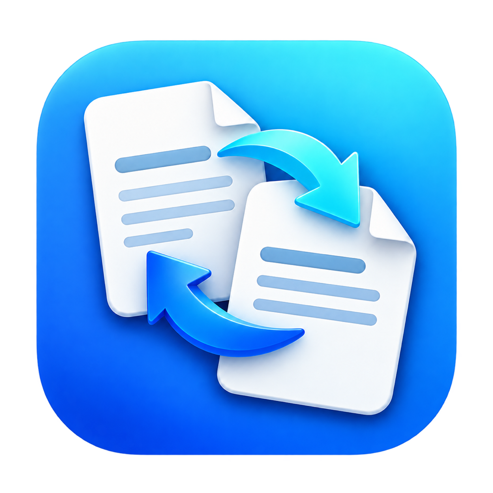

# MDw2d



MDw2d 属于 MD（“嘛的”）系列，名称取自 **wps to docx**。

在 Mac 本机把 Word 无法直接打开的常见文字文档转为 DOCX 的原生应用。SwiftUI 界面支持选文件、拖入文件或文件夹、整目录自动转换、选择输出目录、显示每个文件的结果，以及用 Microsoft Word 打开结果。

适用于 Apple Silicon Mac（M 系列芯片），系统要求 macOS 14 或更新版本。打包后的应用包含 Python 和 LibreOffice 转换引擎，用户不需要安装 WPS、Python 或 LibreOffice。文档的读取、转换和内容核对在本机进行。

## 下载

[下载 MDw2d 0.1.4 测试版（Mac 安装包）](https://github.com/willrong1971/MDw2d/releases/download/v0.1.4/MDw2d-0.1.4.zip)。解压后打开其中的 `MDw2d.app`。

[版本说明与源码包](https://github.com/willrong1971/MDw2d/releases/tag/v0.1.4)。当前应用采用本地 ad-hoc 签名，尚未完成 Apple 开发者签名和公证，其他 Mac 打开时可能出现安全提示。

## 使用与支持范围

选入或拖入文件，选择输出目录后开始转换。应用始终生成新的 `文件名（转换）.docx`，保留原件；同名结果不会被覆盖。

点击“转换文件夹…”，选择文件夹后立即开始。默认勾选“包含子文件夹”，也可取消后仅转换当前层。WPS、DOC、RTF、ODT 等文字文档会自动加入队列，已有 DOCX（包括大写扩展名）跳过；PDF、图片、表格等其他类型不会加入。也可以直接把一个文件夹拖进窗口。

文件夹模式把结果保存在各原文件旁边，同名结果自动编号。某个文件失败会继续处理其余文件，并分别显示结果。再次选择同一文件夹会重新转换仍在其中的旧格式原件。扫描跳过隐藏项目、Office 临时锁文件、符号链接及应用等文件包内部；查找过程中可以取消。选择文件夹会替换窗口中的原转换列表，请单独添加一个文件夹。

实际内部结构决定转换方式，而不是扩展名。

| 识别到的内部格式 | 处理方式 |
| --- | --- |
| 标准 DOCX，即使扩展名为 `.wps` 或 `.doc` | 校验内部结构后保留文件内容；一般为原字节复制，必要时修正 ZIP 内部路径 |
| Word 97–2003 DOC，包括采用该兼容格式的 `.wps` | 转换为 DOCX，并核对正文及可解析的其他内容 |
| RTF、ODT | 转换为 DOCX，并与转换引擎读取的基准核对 |
| 无法识别、损坏、加密或不支持的格式 | 明确提示失败，保留原件 |

转换不会改写正文。引擎输出需要经过文字、表格、图片及可核验的脚注、尾注、页眉页脚、批注和文本框检查；发现差异时停止输出。正文核对保留普通空格、不换行空格、全角空格和文字中的制表符，但会忽略部分格式控制标记、段落换行及动态页码缓存。

排版尽量保持，但不保证与原软件完全一致。字体缺失、复杂表格、分栏等因素可能影响换行和分页，结果仍需用 Word 检查。内容校验通过也不代表已证明所有文档元素都完全保真。

0.1.2 修复了老 DOC 的页眉页脚误报：按原文件的分节、首页和奇偶页分别核对，脚注尾注分隔符单独处理，保留真正的文字差异拦截。另修复转换引擎输出中文字符网格负字距时的整数编码错误，避免由此产生的换行、分页漂移。应用显示版本号；转换成功与排版提醒分开表达，本机缺少原字体时会明确列出字体名称，原字体声明不会被偷偷替换。

0.1.3 补齐不可断连字符和可选连字符的内容核验：准确读取老 DOC 的控制字符及 DOCX 的对应字符节点，避免它们被误判为正文丢字。正文、页眉页脚、脚注等采用相同的字符语义；普通减号、空格与实际缺字仍按原有要求严格核对。

0.1.4 增加文件夹自动转换，支持选择是否包含子文件夹、跳过 DOCX、按原目录保存及同名编号；批量清单支持大量文件，单份失败继续处理。应用使用单窗口，避免恢复多个窗口后重复启动同一批转换。

当前并非所有金山 WPS 私有格式都能转换。某些较早的 Word 格式、加密文档、宏、无法可靠核验的嵌入对象及修订记录会被拒绝。单文件目前限制为 100 MB。有效 DOCX 的原样复制与旧格式转换采用不同校验路径。

## 仓库结构

```text
engine/                  Python 转换核心、非正文内容核对与排版属性修复
native/Sources/          SwiftUI 原生界面
native/Info.plist        应用信息
native/build.sh          编译和自包含应用打包
assets/                  应用图标
tests/                   合成测试生成、转换与审计源码
```

仓库只保存源代码、图标和说明。用户文档、转换结果、提取正文、应用包及第三方运行时均不纳入 Git。

## 构建

需要 Apple Silicon Mac、Xcode 命令行工具，以及可重定位的 CPython 3.12 和 Apple Silicon LibreOffice 应用目录。脚本使用系统 `rsync`、`ditto`、`codesign`、`plutil`。安装 Xcode 命令行工具后，可先检查界面编译：

```sh
bash native/build.sh --compile-only
```

构建自包含应用，并明确指定第三方运行时目录：

```sh
bash native/build.sh \
  --destination build/package \
  --python-home /absolute/path/to/python \
  --libreoffice-app /absolute/path/to/LibreOffice.app
```

路径也可通过 `PYTHON_HOME`、`LIBREOFFICE_APP` 环境变量设置。在本机已有 Codex 依赖运行时的情况下，默认查找 `$HOME/.cache/codex-runtimes/codex-primary-runtime/dependencies` 下对应目录；这只是开发环境的便捷默认值，其他电脑应使用上述参数。默认从 `engine/converter.py` 复制转换核心，也支持 `--converter` 指定其他位置。

默认打包最小 CPython 3.12 标准库与完整 LibreOffice 应用，并保留随附许可。`--full-python` 可复制完整 Python 运行时。图标默认读取 `assets/AppIcon.icns`，也可用 `--icon` 或 `APP_ICON` 指定。目标位置已有同名应用时拒绝覆盖。

当前应用采用本地 ad-hoc 签名，尚未完成 Developer ID 签名和公证。第三方许可说明见 [THIRD-PARTY-NOTICES.md](native/THIRD-PARTY-NOTICES.md)。

## 测试

合成测试生成器构造中英文、空格、表格、图片、页眉页脚、脚注、批注及编号等内容，再导出多种格式。测试包含 9 个正常输入和 3 个异常输入；其中有扩展名与真实格式不一致的文件。

安装测试工具依赖后运行：

```sh
python3 -m pip install -r tests/requirements.txt
python3 tests/run_tests.py --engine /absolute/path/to/LibreOffice.app/Contents/MacOS/soffice
```

可用 `LO_ENGINE` 指定引擎，用 `--work-dir` 指定测试中间文件目录；默认输出到被 Git 忽略的 `tests/_work/`。测试会核验原件哈希、成功/失败状态、DOCX 原样复制及独立内容审计。内置转换核心仅依赖 Python 标准库，上述第三方 Python 包只用于测试生成和审计。

文件夹扫描测试不需要转换引擎：`bash native/test-folder-scanner.sh`。批量清单与输出位置测试可单独运行：`python3 tests/test_batch_inputs.py`，也已纳入完整测试入口。文件夹扫描会查找 `.wps`、`.doc`、`.rtf`、`.odt` 以及常见文字模板和宏文档扩展名，但实际能否转换仍取决于内部格式；含宏等不支持内容会明确提示失败。

2026 年 10 月 12 日的原型验证记录：9 个正常用例通过内容审计，3 个异常用例正确拒绝，12 个输入哈希均保持不变。该记录来自当前引擎的合成测试，不代表对所有私有 WPS 格式或复杂版式的全面支持。详细边界见 [tests/VALIDATION.md](tests/VALIDATION.md)。

